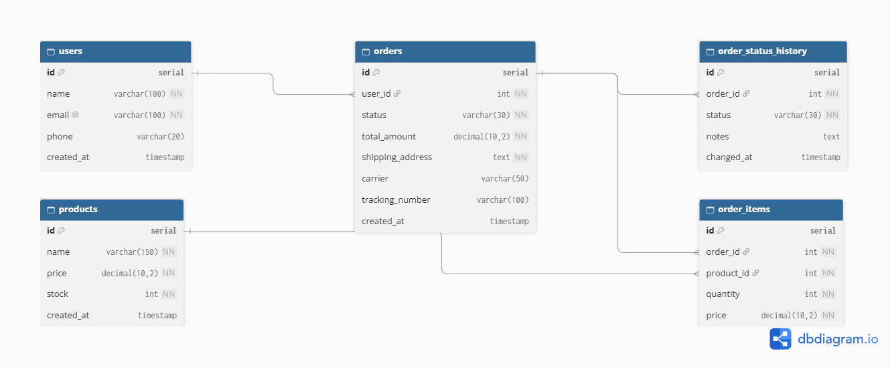

# Order Fulfillment & Status Transitions DB

A simple PostgreSQL database schema to handle order tracking, line items, and fulfillment status updates (from pending to delivered).

Interactive ERD link: https://dbdiagram.io/d/Order-Fulfillment-and-Status-Transitions-Schema-6ae4dfaaf99a5c458bbeaa96



## What this does

When a customer places an order on an e-commerce site, the system needs to save the order details, the items bought, the delivery address, and the courier tracking info. As the warehouse packs the box and hands it over to the courier, the order status changes (e.g. Pending -> Packed -> Shipped -> Delivered). This schema keeps track of the current status of each order, while also saving a log of every status change so we have a full history of when things happened.

## Tables

- **users**: Stores customer accounts (name, email, phone). It's separate from orders because one user can place many orders over time, so we don't want to duplicate user info on every order.
- **products**: Stores the item catalog with current price and available stock. It needs its own table so we can update stock levels and prices in one place without touching order records.
- **orders**: Stores the main order record, including who bought it, total amount, shipping address, courier name, tracking number, and current status. This ties the whole transaction together.
- **order_items**: Stores the items inside each order, along with quantity and price at purchase. It exists because one order can have multiple products and one product can be in many orders (many-to-many relationship).
- **order_status_history**: Stores an audit log of each status change with a timestamp and optional notes. It's separate because the `orders` table only keeps the current status, and we don't want to lose the timestamp of earlier stages (like when it was packed or shipped).

## Foreign Keys & Relationships

- `orders.user_id -> users.id`: Links the order to the customer who placed it.
- `order_items.order_id -> orders.id`: Links each item row to its parent order.
- `order_items.product_id -> products.id`: Links the item row to the product being bought.
- `order_status_history.order_id -> orders.id`: Links each status log entry to the order it belongs to.

## Design Tradeoff

I decided to store the `shipping_address`, `carrier`, and `tracking_number` directly inside the `orders` table instead of creating separate `addresses` and `shipments` tables. 

In a massive enterprise system like Amazon where orders get split into multiple packages or users pick from a saved address book, separate tables make sense. But for a simple fulfillment flow where one order equals one package sent to one address, keeping them in `orders` avoids extra joins, keeps queries fast and simple, and makes the schema much easier to read and maintain.

## Indexing & Normalization

- **Indexing**: PostgreSQL does not automatically index foreign keys. I added indexes on `orders(user_id)`, `order_items(order_id)`, `order_items(product_id)`, and `order_status_history(order_id)` so joins run fast instead of doing full table scans. I also indexed `orders(status)` to make filtering orders (like finding all 'Pending' orders to pack) quick.
- **Normalization**: The schema is in 3rd Normal Form (3NF). There are no repeating groups (order items are broken out into their own table), and each column depends directly on the primary key of its table. 
- **Price snapshot**: In `order_items`, I deliberately stored `price` at the time of purchase. If a product price changes later in the `products` table, old order totals won't get changed.

## Running the script

```bash
psql -d your_database -f schema.sql
```
